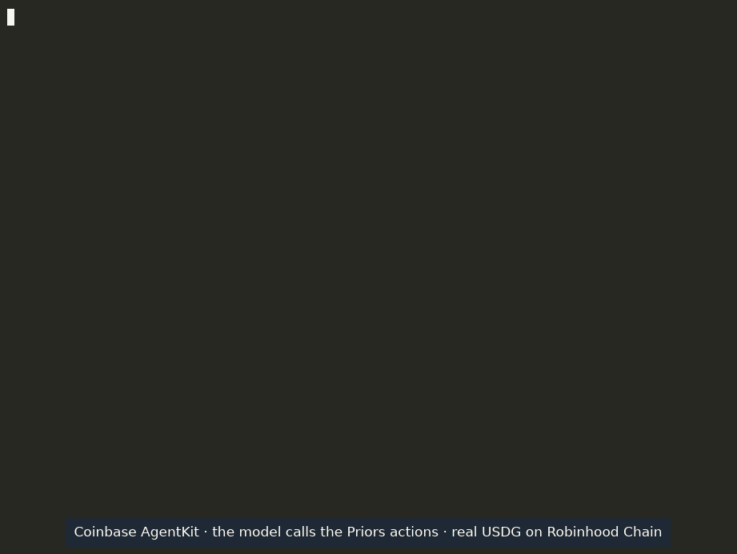

# @priors/agentkit

A [Coinbase AgentKit](https://github.com/coinbase/agentkit) action provider for [Priors](https://priors.trade): an
ERC-8004 agent on Robinhood Chain pays x402 APIs in USDG and, when its wallet is short, borrows the gap from its Priors
credit line, then repays. Before paying another agent it can read that agent's repayment record.

The same provider is proposed to AgentKit itself (`priorsActionProvider` in `@coinbase/agentkit`); this package makes
it usable with the AgentKit already on npm.

## Install

The package is not on npm yet. From a clone of [priors-agents/priors](https://github.com/priors-agents/priors):

```bash
cd priors/integrations/agentkit && npm install && npm pack        # builds, -> priors-agentkit-0.1.0.tgz
cd /path/to/your-agent && npm install /path/to/priors-agentkit-0.1.0.tgz @coinbase/agentkit
```

## Use

```ts
import { AgentKit, ViemWalletProvider } from "@coinbase/agentkit";
import { priorsActionProvider } from "@priors/agentkit";
import { createWalletClient, defineChain, http } from "viem";
import { privateKeyToAccount } from "viem/accounts";

const robinhood = defineChain({
  id: 4663,
  name: "Robinhood Chain",
  nativeCurrency: { name: "Ether", symbol: "ETH", decimals: 18 },
  rpcUrls: { default: { http: ["https://rpc.mainnet.chain.robinhood.com"] } },
});
const walletProvider = new ViemWalletProvider(
  createWalletClient({ account: privateKeyToAccount(KEY), chain: robinhood, transport: http() }),
);
const agentKit = await AgentKit.from({ walletProvider, actionProviders: [priorsActionProvider()] });
```

Then hand `agentKit` to your framework as usual (`getVercelAITools(agentKit)`, `getLangChainTools(agentKit)`, ...).

## Actions

| Action | What it does | Moves money |
|---|---|---|
| `get_priors_agent_record` | reads an agent's repayment record: loans repaid, late repayments, defaults, score | no |
| `get_priors_credit_line` | reads an agent's line: size, drawn, available | no |
| `pay_x402_with_priors_credit` | pays an x402 URL in USDG, at most `maxPrice`; if the wallet is short, first borrows the gap (at least the pool's minimum loan, 5 USDG today) only when `maxBorrow` covers it | yes |
| `borrow_from_priors` | borrows USDG from the agent's line into the wallet | yes |
| `repay_priors_loan` | repays a loan in full; approves exactly what is due | yes |

Only the agent's owner or its registry wallet can borrow against or repay its line. A loan more than three days late
can be marked defaulted, which ends the agent's record on Priors. The reads use Priors' public API, no key.

## Known issue in AgentKit

AgentKit sends an analytics event on every action call (to `cca-lite.coinbase.com/amp`). That endpoint answers HTTP
400 today, and AgentKit's action decorator leaves the rejection unhandled, which ends a Node process on the first
action call. [coinbase/agentkit#1537](https://github.com/coinbase/agentkit/pull/1537) fixes it. Until it ships, a Node
host can log that one error instead:

```ts
process.on("unhandledRejection", (e) => {
  if (e instanceof Error && /^HTTP error! status: \d+$/.test(e.message)) return console.warn("AgentKit analytics:", e.message);
  throw e;
});
```

## Demo



A production run on 2026-10-30 (agent #437, Robinhood Chain mainnet; the model calling these actions through
`@coinbase/agentkit-vercel-ai-sdk`), its own output lines with waits over 6 seconds shortened. The agent reads the
seller's record (Blockpin, agent #9233), pays its x402 check (0.10 USDG) from an empty wallet by borrowing 5 USDG (loan
#50884), and repays 5.011666 USDG after its income arrives.
Transactions: [borrow](https://robinhoodchain.blockscout.com/tx/0x297608c51007480ec8c5aa510d78926d6f14bf58ed467cb797aedc5922884a9e),
[payment](https://robinhoodchain.blockscout.com/tx/0xbb7fd5dcc13ac547873516713e4940cecadcda76873d980d3ad402de48288c19),
[repayment](https://robinhoodchain.blockscout.com/tx/0xae5ab2472941bae4ff9d63394247eec90fcf3d2feddd508a4d9e5ebd7ac90c6d).

## Test

```bash
npm test   # builds, then runs test/*.test.cjs against the published @coinbase/agentkit
```

## License

MIT
