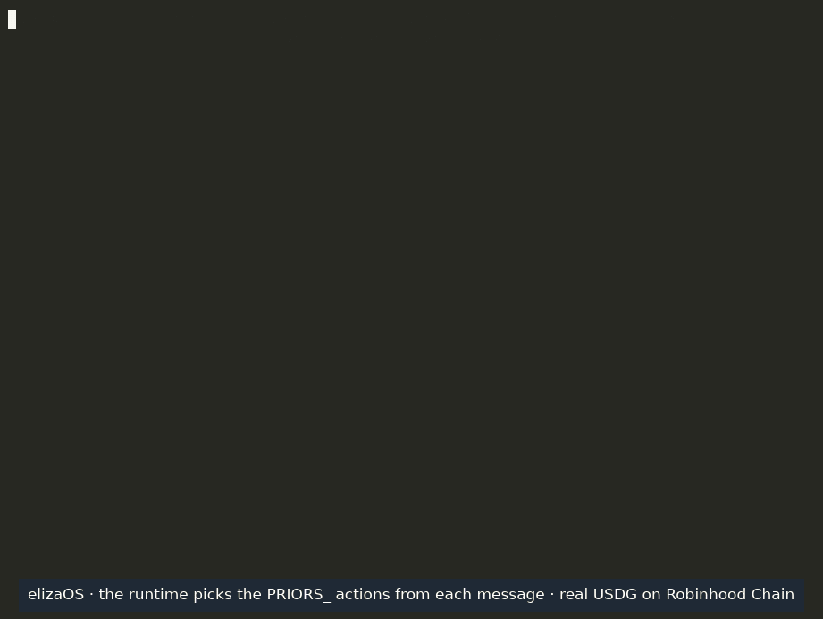

# @priors/plugin-elizaos

Priors credit for [elizaOS](https://github.com/elizaOS/eliza) agents. An agent pays HTTP 402 (x402) APIs in USDG
from its wallet on Robinhood Chain; when the wallet is short, it borrows the gap from its
[Priors](https://priors.trade) credit line and repays it. Before paying another ERC-8004 agent, it can read that
agent's repayment record.

## Install

The package is not on npm yet. From a clone of [priors-agents/priors](https://github.com/priors-agents/priors):

```bash
cd priors/integrations/elizaos && npm pack                        # -> priors-plugin-elizaos-0.1.0.tgz
cd /path/to/your-agent && npm install /path/to/priors-plugin-elizaos-0.1.0.tgz
```

Add it to the character's plugins (elizaOS 1.7 or later):

```json
{
  "name": "MyAgent",
  "plugins": ["@elizaos/plugin-sql", "@elizaos/plugin-bootstrap", "@elizaos/plugin-openrouter", "@priors/plugin-elizaos"],
  "settings": {
    "secrets": {
      "PRIORS_KEY_FILE": "/path/to/agent-wallet.key",
      "PRIORS_AGENT_ID": "1234",
      "PRIORS_PAY_HOSTS": "check.blockpin.dev"
    }
  }
}
```

| Setting | What it is |
|---|---|
| `PRIORS_KEY_FILE` | a file holding the agent wallet's private key, readable by this user only (`chmod 600`); a dedicated wallet, never a main one (`PRIORS_KEY` works too) |
| `PRIORS_AGENT_ID` | the agent's ERC-8004 id on Robinhood Chain |
| `PRIORS_PAY_HOSTS` | the only hosts a payment may go to, comma-separated |
| `PRIORS_MAX_PRICE_USD` | most one x402 call may cost (default 1.00) |
| `PRIORS_STATE_DIR` | where the daily caps and sent payments are kept: a directory only this user can write to, with no group- or world-writable parent (otherwise nothing is signed) |
| `PRIORS_MAX_SPEND_DAY_USD`, `PRIORS_MAX_BORROW_DAY_USD` | optional daily caps |

Without a key, only `PRIORS_AGENT_RECORD` works.

## Actions

| Action | What it does | Moves money |
|---|---|---|
| `PRIORS_AGENT_RECORD` | reads another agent's record on the hosted read-only Priors server: its line, repaid and late loans, defaults, score. The message names the agent, as `#1234` | no |
| `PRIORS_CREDIT_STATUS` | reads this agent's own line: available, drawn, open loans and due dates | no |
| `PRIORS_PAY_X402` | pays an x402 URL at most the price the message names; if the wallet is short, borrows the gap only when the message names the most to borrow (`borrow up to 5`; a loan is at least the pool's minimum, 5 USDG today) | yes |
| `PRIORS_REPAY` | repays the loan the message names (`loan 50900`), principal and fee | yes |

Example messages:

- "Before we pay it, check agent #9233's record on Priors."
- "Pay https://check.blockpin.dev/check at most 0.10, borrow up to 5 if the wallet is short."
- "Repay loan 50900 now."

## How it works

The plugin runs [`@priors/mcp`](https://www.npmjs.com/package/@priors/mcp) in process for the agent's own wallet,
and reads records from the hosted read-only server at `https://mcp.priors.trade/mcp`. Every cap, the host
allowlist and the signing are `@priors/mcp`'s own: a payment above `max_price_usd` or to a host outside
`PRIORS_PAY_HOSTS` is refused before anything is signed, and the server's totals (`PRIORS_MAX_SPEND_USD` 5 and
`PRIORS_MAX_BORROW_TOTAL_USD` 25 by default while it runs) bound what one process can spend or borrow. Amounts and
URLs are read from the user's message, never chosen by the model.

## Disclosure

- Payments and loans are real money: USDG on Robinhood Chain mainnet, signed with the key in `PRIORS_KEY_FILE`.
- A loan more than three days late can be marked defaulted, which ends the agent's record on Priors.
- The hosted server counts each connection by its client's runtime name only (https://mcp.priors.trade/privacy).

## Demo



A production run in elizaOS 1.7.2 on 2026-10-30 (agent #437, Robinhood Chain mainnet), its own output lines with waits
over 6 seconds shortened. The agent reads the seller's record (Blockpin, agent #9233), then pays its x402 check (0.10
USDG) from an empty wallet: PRIORS_PAY_X402 borrows 5 USDG, the pool's minimum loan (loan #50896). The agent's income
then arrives from another wallet, and PRIORS_REPAY closes the loan for 5.011666 USDG.
Transactions: [borrow](https://robinhoodchain.blockscout.com/tx/0x1a17ff6a4f4329d4a16fee0c7654f43104b037a0d9109f9c7ee4c503cbdd2d81),
[payment](https://robinhoodchain.blockscout.com/tx/0xc508fd46c613aa642bf8fe3c609c2b93eea00f93c173bdda5945e461e0c060c1),
[repayment](https://robinhoodchain.blockscout.com/tx/0x4186f11d1db84408740dbf7154f71978ef8301d54c7c1a6ef80704737f87c342).

## Test

```bash
npm test
```

## License

MIT
