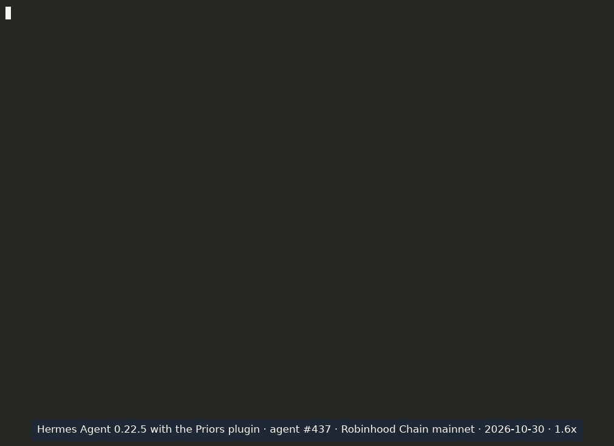

# Priors for Hermes Agent

A [Portable Agent Plugins v1](https://agent-plugins.org) package for [Hermes Agent](https://github.com/NousResearch/hermes-agent).
It lets a Hermes agent pay HTTP 402 (x402) APIs on credit: when its wallet is short, it borrows the gap in USDG from
its [Priors](https://priors.trade) credit line on Robinhood Chain, pays, and repays. Before paying another ERC-8004
agent it can read that agent's repayment record.

It bundles two MCP servers and one skill:

| Server | What it is | Moves money |
|---|---|---|
| `priors` | the hosted, read-only Priors MCP server, `https://mcp.priors.trade/mcp` (no key, no sign-in) | no |
| `priors-wallet` | the local `priors-mcp` command from npm [`@priors/mcp`](https://www.npmjs.com/package/@priors/mcp), signing with the agent's own wallet | yes |
| `skills/priors` | when to use the tools, in what order, and what to confirm with the user first | no |

## Install

```bash
npm install -g @priors/mcp@0.14.1        # the priors-mcp command
hermes plugins install priors            # once listed in Hermes's plugin catalog
hermes plugins enable priors             # portable packages install disabled
```

Then, in the Hermes profile's `.env`:

```bash
PRIORS_KEY_FILE=/path/to/agent-wallet.key   # chmod 600; a dedicated wallet, never a main one
PRIORS_AGENT_ID=1234                        # the agent's ERC-8004 id
PRIORS_PAY_HOSTS=check.blockpin.dev         # the only hosts pay_url may pay
PRIORS_STATE_DIR=~/.priors/state           # where the daily caps and sent payments are kept
PRIORS_MAX_SPEND_DAY_USD=5                  # optional daily caps
PRIORS_MAX_BORROW_DAY_USD=5
```

Hermes hands the server only the variables `mcp.json` names, so these are the ones that reach it: the five above,
`PRIORS_KEY` (instead of `PRIORS_KEY_FILE`), `PRIORS_MAX_PRICE_USD` (most a call, default 1.00),
`PRIORS_MAX_BORROW_USD` (most a borrow, default 25), `PRIORS_MAX_SPEND_USD` and `PRIORS_MAX_BORROW_TOTAL_USD` (totals
while the server runs, defaults 5 and 25) and `PRIORS_RPC` (another Robinhood Chain node). Any other setting stays at
`@priors/mcp`'s default.

`priors-mcp` is a Node.js command, so `node` must be on the PATH Hermes runs with. It signs nothing when
`PRIORS_STATE_DIR` sits under a directory other users can write to (its record of sent payments and daily totals could
be tampered with): use a directory only you can write to (`chmod 700`), with no group- or world-writable parent.

Without a key only the read-only `priors` server is useful: records, sellers, pool data.

## What it does

1. `credit_status` reads the agent's own line, the amount available and its open loans.
2. `agent_record(agent_id)` on the read-only server reads another agent's record: its line, repaid and late loans,
   defaults and score.
3. `pay_url(url, max_price_usd, max_borrow_usd)` fetches the URL; on HTTP 402 it pays in USDG at or below
   `max_price_usd`, and if the wallet is short it borrows the gap from the line when `max_borrow_usd` covers it. A loan
   is at least the pool's minimum (5 USDG today), so a 0.10 payment from an empty wallet borrows 5.
4. `repay(loan_id)` repays the loan, principal and fee.

## Disclosure

- Payments and loans are real money: USDG on Robinhood Chain mainnet, signed by the key in `PRIORS_KEY_FILE` (or
  `PRIORS_KEY`) in the Hermes profile's `.env`.
- Both servers are marked `untrusted`, so Hermes asks the user before every tool call that is not read-only, including
  every payment, borrow and repayment. The plugin never auto-approves one. Where nobody can answer (`hermes chat -q`,
  cron, the messaging gateway without a prompt), Hermes declines the call and nothing is paid.
- `pay_url` pays only the hosts in `PRIORS_PAY_HOSTS`, never more than `max_price_usd` a call (and the server's
  `PRIORS_MAX_PRICE_USD`, 1.00 by default), and borrows only when `max_borrow_usd` is given. The server's own totals
  (`PRIORS_MAX_SPEND_USD` 5 and `PRIORS_MAX_BORROW_TOTAL_USD` 25 by default while it runs, and the daily caps above)
  bound what one session can spend or borrow.
- A loan more than three days late can be marked defaulted, which ends the agent's record on Priors.
- The hosted server receives the tool calls' public arguments (agent ids, addresses) and counts each connection by
  the client's runtime name only: https://mcp.priors.trade/privacy.
- The tools are served by `@priors/mcp` and by the hosted server; their code is open in
  https://github.com/priors-agents/priors.

## Demo



A production run in Hermes Agent 0.22.5 on 2026-10-30 (agent #437, Robinhood Chain mainnet), cut to 58 seconds at 1.6x
speed. The agent reads the seller's record (Blockpin, agent #9233), then pays its x402 check (0.10 USDG) from an empty
wallet: `pay_url` borrows 5 USDG, the pool's minimum loan (loan #50891), after Hermes asks and the user allows it once.
The agent's income then arrives from another wallet, and `repay` closes the loan for 5.011666 USDG.
Transactions: [borrow](https://robinhoodchain.blockscout.com/tx/0x542517bb4f7e7742fd749b7b8cab732e0a9d21af70bc433b079a72f655a9ea70),
[payment](https://robinhoodchain.blockscout.com/tx/0xc9c4bd8afef8bc170582f23055f60ea5ba9de58d2977ae6872a8dbc35d37e898),
[repayment](https://robinhoodchain.blockscout.com/tx/0x5cf0959fd332739ff6c8f7f7df8aa388a5330446da21d1b7a6400426fd83b621).

## License

MIT
